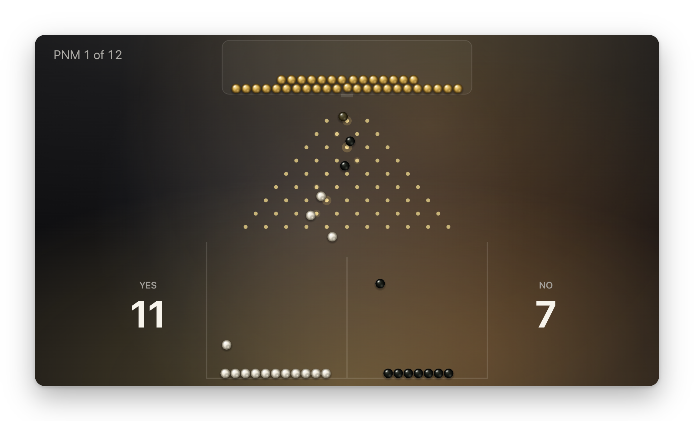
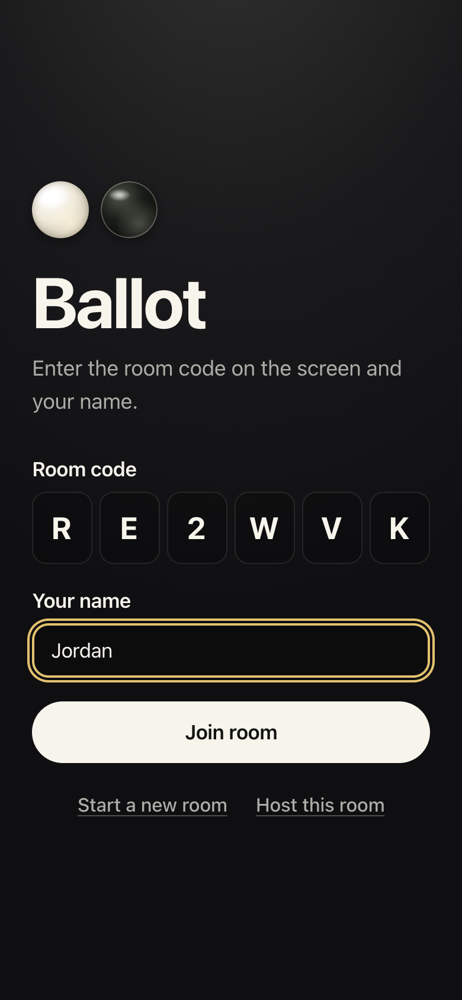
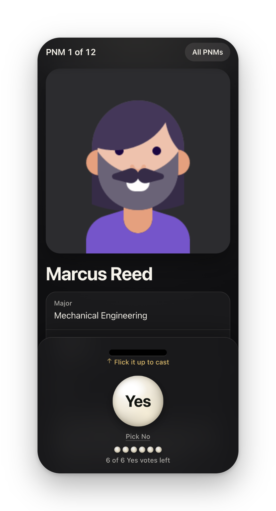
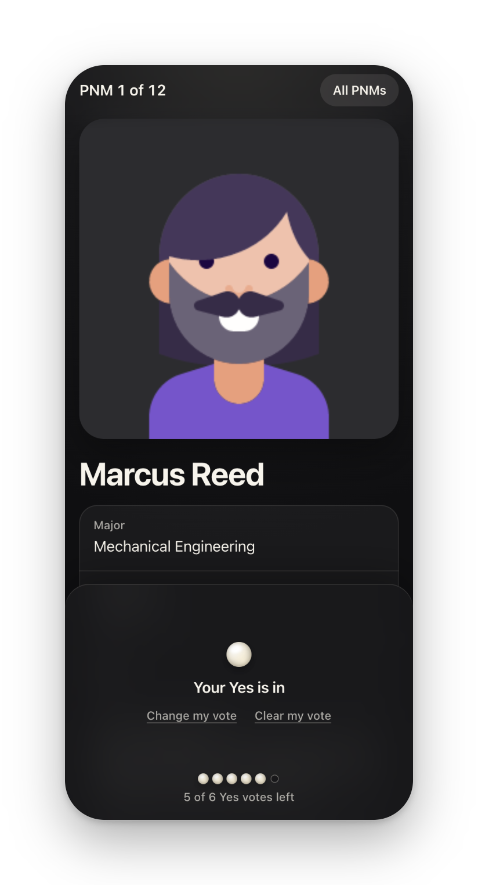
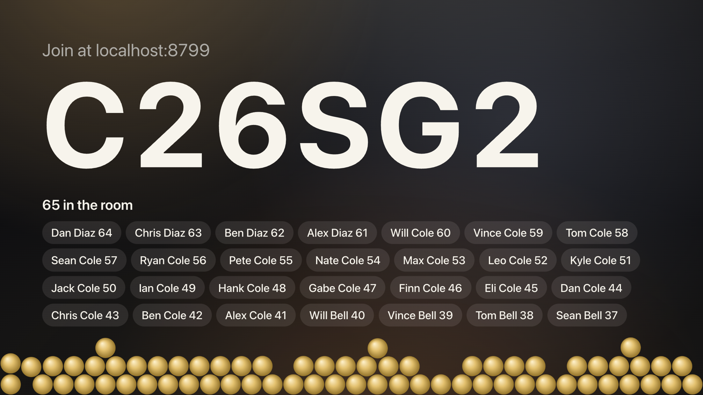
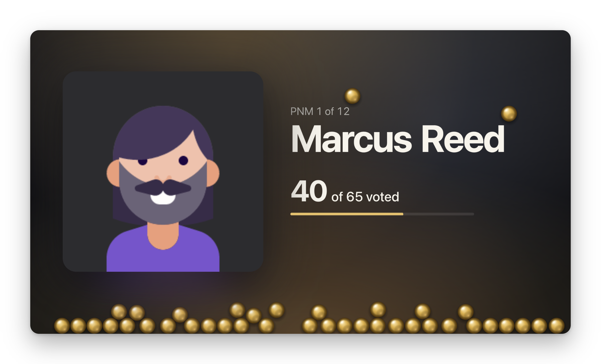
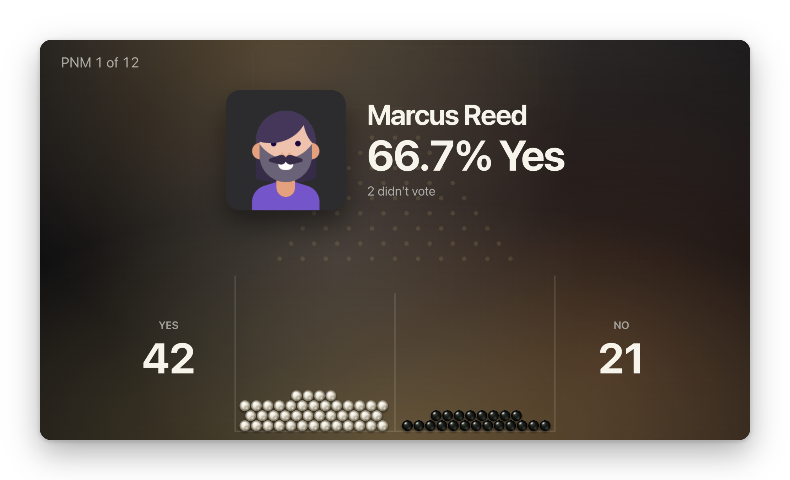
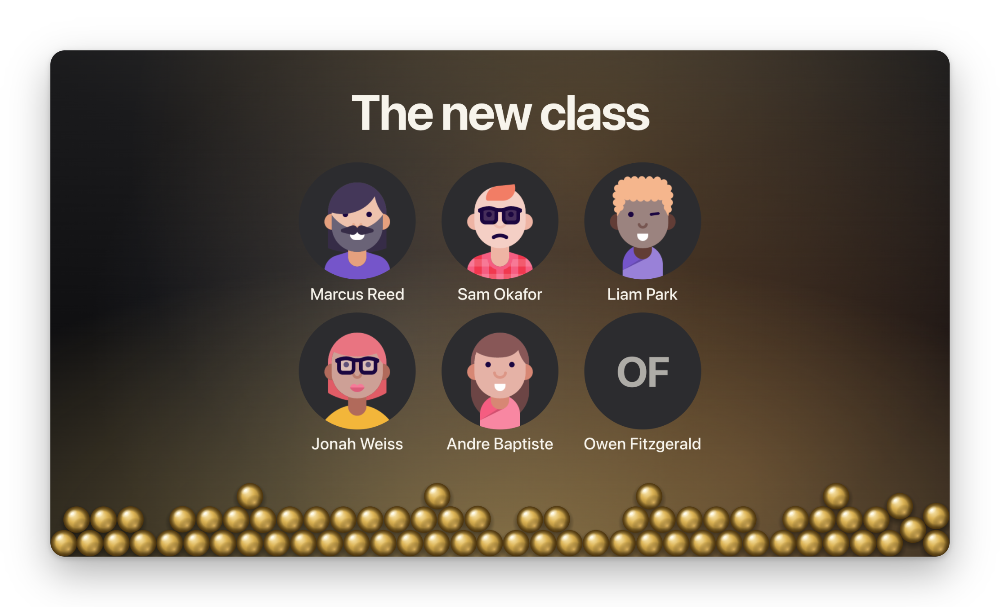
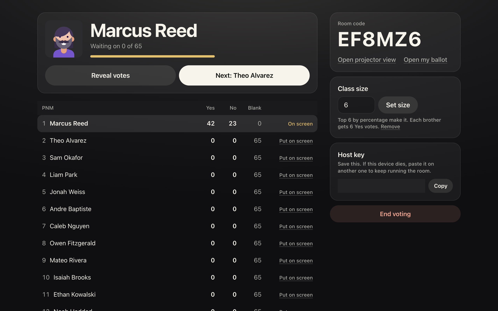
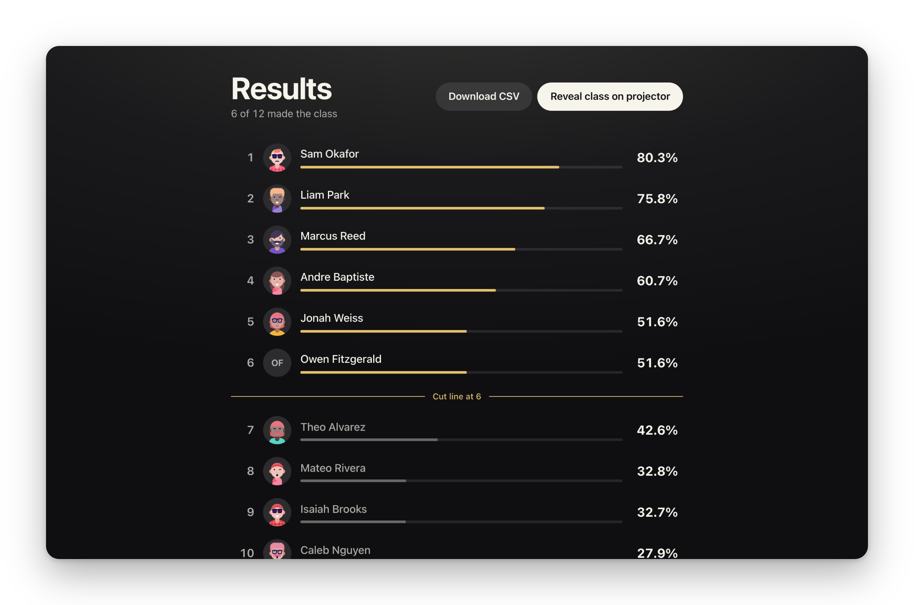

<h1 align="center">Ballot</h1>

<p align="center">
  Live, secret Yes/No voting for a room full of phones, with a projector that turns every ballot into a marble.
</p>

<p align="center">
  <a href="https://ballot.monck.dev"><strong>ballot.monck.dev</strong></a>
  ·
  <a href="https://github.com/jacobmonck/ballot/actions/workflows/deploy.yml"></a>
</p>

<p align="center">
  
</p>

Ballot runs a fraternity's new-member vote, and its officer elections too. After the pro/con/pro discussion on each
candidate (a PNM), the host puts them on screen. Every brother votes on their phone with
the PNM's photo and form answers in front of them, and the projector shows a gold marble
for each ballot as it lands. When the host reveals the result, the marbles drop through
a pegboard into Yes and No bins, one at a time, with sound.

## Highlights

- **Secret until the host says so.** Phones only ever learn their own votes. The projector
  shows that a ballot landed, never which way: every marble is gold and makes the same
  sound until the reveal. Tallies are frozen at the moment of the reveal, so late changes
  can't leak.
- **A reveal the room watches.** Each marble's path through the pegboard is planned before
  the first one drops, so it always lands in its own bin with no visible correction. The
  pegs add bounce, not chance. The last five marbles slow down, so a close vote stays tense.
- **Flick to vote.** Brothers pick Yes or No, then flick the marble up off the screen to
  cast it. A tap works too, and reduced motion keeps a one-tap ballot.
- **Built for a real night.** Phones reconnect on their own, the projector rejoins a reveal
  in progress without replaying it, and the host can move the room to another device with
  a key. A room holds 1,000 brothers.
- **Cheap to run.** One Cloudflare Durable Object per room holds the state in SQLite and
  speaks WebSocket to every screen. The site itself is static.

## Screens

**On the phone.** Join with the code on the projector, pick a side, and flick it in.

<p align="center">
  
  
  
</p>

**On the projector.** The lobby fills as brothers join, then gold marbles pile up as
ballots land.

<p align="center">
  
  
</p>

After the drop, the result locks in with a bell, and at the end of the night the new
class is revealed one person at a time.

<p align="center">
  
  
</p>

**On the host's laptop.** Run the room with live counts, then rank everyone against the
cut line.

<p align="center">
  
  
</p>

Screenshots use made-up people from `docs/sample-pnms.csv` and simulated voters.

## How it works

```
  phones ────┐            ┌────────────────────────────────┐
  host ──────┼─ WebSocket ┤  Durable Object, one per room  ├── R2: saved photos
  projector ─┘            │  SQLite: PNMs, votes, room     │
                          └────────────────────────────────┘
```

- **Server** (`src/worker`): a Worker routes `/api/rooms/:code` to that room's Durable
  Object. The object validates every message, stores the room in SQLite, and sends each
  role only what it may see: brothers get their own votes, the projector gets progress
  until a reveal, and only the host gets tallies.
- **Client** (`src/client`): React with a reducer that applies server patches to a
  snapshot. Host and projector screens load on demand, so a phone downloads only the ballot.
- **Pegboard** (`pegboard.ts`, `pegboardRun.ts`): a pure, DOM-free planner. Each marble
  takes nine left/right turns; nine can never cancel out, and a run that would end on the
  wrong side is mirrored, so both bins look equally likely while the bin is guaranteed.
  Paths are chains of ballistic arcs between pegs, played back on a canvas that sleeps when
  nothing moves.
- **Sound** (`sound.ts`): synthesized with Web Audio, no files. The projector asks once to
  turn sound on, since browsers block audio until a click.

**Stack:** TypeScript, React 19, Vite, Tailwind CSS 4, Motion, Canvas 2D, Web Audio,
Cloudflare Workers, Durable Objects, R2, Vitest, Bun, oxlint, GitHub Actions.

## Run it

```sh
bun install
bun run test        # server, client state and pegboard tests
bun run preview     # builds the site and serves everything at http://localhost:8787
```

For front-end work, run `bun run dev:worker` and `bun run dev` in two terminals. Vite
serves the site and proxies `/api` to the Worker. `bun run dev` alone can't reach the API.

To try a full room, paste `docs/sample-pnms.csv` into the host screen, then fill the room with
fake brothers who vote on whatever is on screen:

```sh
bun scripts/simulate.mjs ROOMCODE 100
```

The simulator also fills election rooms: its brothers pick random candidates on whatever
position is open.

Before a change lands: `bun run test`, `bun run typecheck`, `bun run lint` and
`bun run format:check`.

## Deploy

```sh
bunx wrangler r2 bucket create ballot-photos   # once
bunx wrangler login
bun run deploy
```

Pushing to `master` deploys automatically once tests and typecheck pass. GitHub needs a
`CLOUDFLARE_API_TOKEN` secret in its `production` environment, which only allows
`master`, and a `CLOUDFLARE_ACCOUNT_ID` repository variable. Pull requests run the same
checks without deploying. To roll back, run `bunx wrangler rollback` or revert the commit.

## Running a voting night

1. On a laptop, choose **Start a new room**.
2. Paste the form responses and match each column. Check every photo loaded.
3. Copy the host key somewhere safe. It's the only way to move the room to another device.
4. Set **Class size**. This is also how many Yes votes each brother gets.
5. Choose **Open projector view** and put it on the big screen. That link carries a
   private key, so keep it to the projector. Brothers join with the code.
6. Choose **Start voting**, then **Next** after each pro/con/pro. To show the room a
   result, choose **Reveal votes**.
7. Choose **End voting** when finished. This freezes votes.
8. Once no tie is left, choose **Reveal class on projector**. It shows only who made the
   class, in interview order, with no percentages or rank.

PNMs are ranked by Yes votes out of Yes and No votes cast. The top PNMs up to the class
size make it. If PNMs tie across the cut line, results offer **Start revote**: brothers
vote again on just the tied PNMs, without the Yes limit, until the tie breaks.

To vote as well as host, use **Open my ballot** on your own phone or in a new tab.

### Elections

Officer elections use the same room and the same phones. Choose **Elections** on the setup
screen before adding anything. The mode locks once voting starts.

1. Add each position with its number of seats and its candidates.
2. Choose **Start voting on** a position. Each brother picks up to as many candidates as
   there are open seats, and the projector shows how many have voted.
3. Choose **Close round** to see the tallies. Candidates with a majority win seats. If
   seats are still open, choose **Open runoff**, or **Reveal winners** when the race is
   decided. Then choose **Open** the next position.
4. Choose **End voting** when every position is done.
5. Choose **Reveal slate on projector** to show the elected officers.

A candidate wins with a majority: more than half of the brothers who picked anyone. When
no one wins outright, the runoff drops the last-place candidate (all of them, if tied) and
brothers vote again; if that leaves no more candidates than open seats, they are elected.

### Photos

Google Drive photos are copied into R2 once on import, so phones load them from Ballot
instead of Drive. Before importing, share the Drive folder with **Anyone with the link**.
You can turn that off once the host screen has saved every photo. If some fail, fix the
sharing and choose **Try again**.

### Limits and data

- Rooms and all their data, including saved photos, are erased after 30 days without use.
  Download the CSV first.
- A room holds up to 1,000 brothers and 500 PNMs, or 50 positions with 50 candidates each.
- Each address can start 10 rooms a minute and make 1,200 room requests a minute.
- One device can send 60 messages every 10 seconds.
- Anyone with the room code can join under any name. Check the list, then choose **Close
  to new names** before voting starts. Brothers already in the room can still return.
