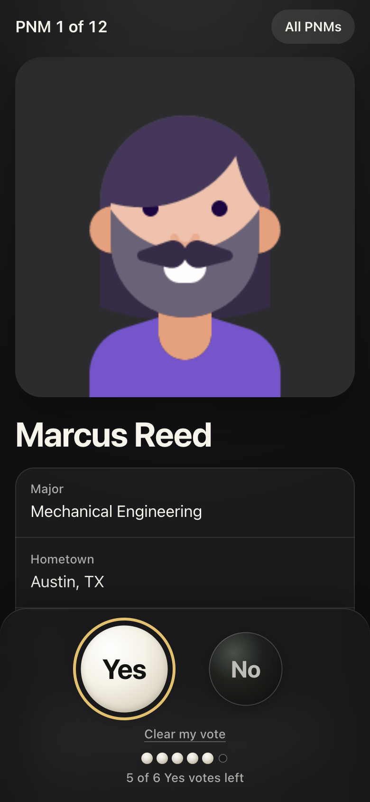

# Ballot

Live Yes/No voting for new members. After pro/con/pro on a PNM, the host puts them on
screen and every brother votes on their phone with the PNM's photo and form answers in
front of them.

Game logic runs in one Cloudflare Durable Object per room. The React site is static and
talks to it over a WebSocket.

## Previews

The projector, with marbles dropping as ballots land:


The host can reveal a result, which sorts the marbles into Yes and No:


| Join | Ballot |
| --- | --- |
|  |  |

The host runs the room and sees live counts:


Results rank PNMs by percentage, with a cut line at the class size:


The host can then reveal the class on the projector, one name at a time:


Previews use made-up people from `sample-pnms.csv` and simulated voters.

## Run it

```sh
npm install
npm test            # server and CSV tests
npm run preview     # builds the site, serves everything at http://localhost:8787
```

For front-end work, run `npm run dev:worker` and `npm run dev` together. Vite serves the
site and proxies `/api` to the Worker.

## Deploy

```sh
npx wrangler login
npm run deploy
```

## Voting night

1. On a laptop, choose **Start a new room**.
2. Paste the form responses and match each column. Check every photo loaded.
3. Copy the host key somewhere safe. It is the only way to move the room to another device.
4. Set **Class size**. This is also how many Yes votes each brother gets.
5. Open the projector view on the big screen. Brothers join with the code.
6. Choose **Start voting**, then **Next** after each pro/con/pro. To show the room a PNM's
   result first, choose **Reveal votes**. Tallies stay hidden from the projector until you do.
7. Choose **End voting** when finished. This freezes votes.
8. Once no tie is left, choose **Reveal class on projector**. It shows only who made the
   class, in interview order, with no percentages or rank. Brothers' phones don't get it.

PNMs are ranked by percentage: Yes votes out of Yes and No votes cast. The top PNMs up to
the Yes limit make the class. If PNMs tie across that line, results offer **Start revote**.
Brothers vote again on just the tied PNMs, the Yes limit is lifted, and the revote only
orders those PNMs among themselves. Repeat until the tie breaks.

To try a full room, paste `sample-pnms.csv` into the host screen, then fill it with fake
brothers who vote on whatever you put on screen:

```sh
node scripts/simulate.mjs ROOMCODE 100
```

To vote as well as host, use **Open my ballot** on your own phone or in a new tab.
